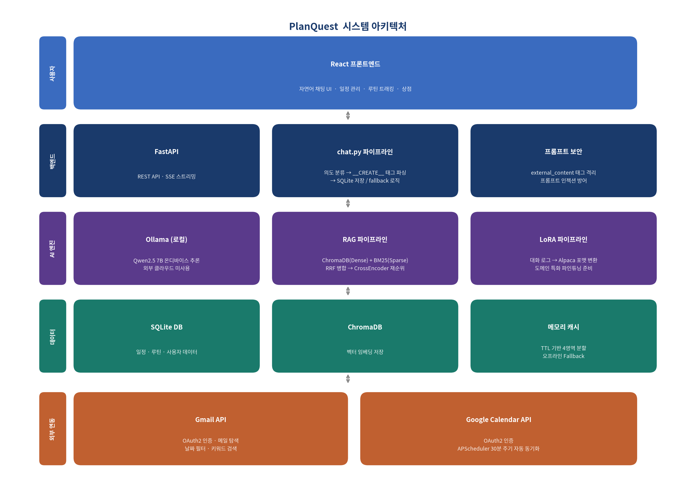
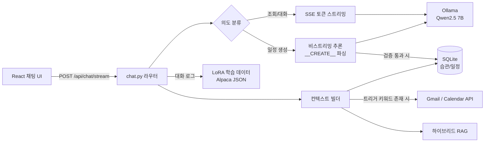
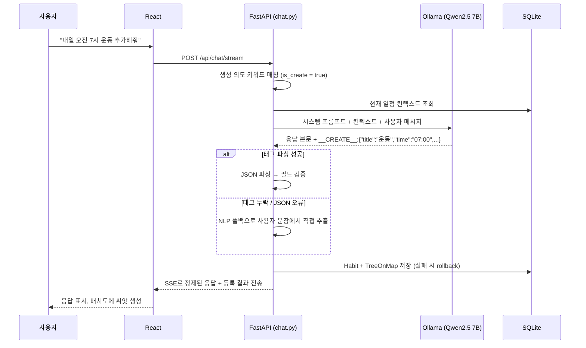

# PlanQuest

**On-device AI Personal Scheduler** — 로컬 LLM 기반 자연어 일정 등록 · Gmail/Google Calendar 연동 · 게임화 습관 관리

`Python` `FastAPI` `React` `SQLite` `Ollama` `Qwen2.5-7B` `ChromaDB` `BM25` `Google OAuth2`

---

## 목차

1. [프로젝트 개요](#1-프로젝트-개요)
2. [시스템 아키텍처](#2-시스템-아키텍처)
3. [핵심 기술 상세](#3-핵심-기술-상세)
4. [트러블슈팅](#4-트러블슈팅)
5. [한계와 향후 과제](#5-한계와-향후-과제)
6. [기술 스택](#6-기술-스택)
7. [저장소 구조](#7-저장소-구조)
8. [실행 방법](#8-실행-방법)
9. [API 명세](#9-api-명세)
10. [팀 구성](#10-팀-구성)

---

## 1. 프로젝트 개요

### 문제 정의

일정·메일·습관 데이터는 개인 정보 밀도가 가장 높은 데이터입니다. 그런데 기존 AI 비서는 이 데이터를 외부 클라우드 LLM으로 전송해야 동작합니다. 반대로 로컬에서 동작하는 습관 관리 앱은 자연어 인터페이스가 없어 사용자가 폼을 직접 채워야 합니다.

### 접근 방식

PlanQuest는 **Qwen2.5 7B 모델을 Ollama로 사용자 PC에서 직접 구동**합니다. 대화, 일정, 메일 본문은 디바이스 밖으로 나가지 않으며(Google API 호출 제외), 사용자는 "내일 오전 7시 운동 추가해줘" 같은 한 문장으로 일정을 DB에 등록할 수 있습니다. 등록한 습관을 완료하면 하트 포인트가 쌓이고, 이를 게임 요소(캐릭터 상점, 정원 배치)에 사용해 지속 동기를 만듭니다.

### 기존 서비스와의 비교

| 서비스 | 로컬 AI | 게임화 | 자연어 일정 등록 |
|--------|:------:|:------:|:---------------:|
| Habitica | X | O | X |
| Open Claw | O | X | O |
| 습관의 숲 | O (로컬 저장) | O | X |
| **PlanQuest** | **O** | **O** | **O** |

---

## 2. 시스템 아키텍처

### 2.1 레이어 구성



| 레이어 | 구성 요소 | 역할 |
|--------|-----------|------|
| 프론트엔드 | React 18 | 채팅 UI(SSE 수신), 일정·루틴 관리, 캘린더 히트맵, 상점·배치도 |
| 백엔드 | FastAPI | REST API, SSE 스트리밍, 의도 분류, `__CREATE__` 태그 파싱, 입력 검증 |
| AI 엔진 | Ollama + Qwen2.5 7B | 로컬 추론. 일정 DB·Gmail·RAG 컨텍스트를 받아 응답 생성 |
| 검색 | ChromaDB + BM25 + Reranker | Dense/Sparse 병렬 검색 후 RRF 병합, bge-reranker 재순위 |
| 데이터 | SQLite | 습관·완료 기록·사용자·게임 상태, 영역별 TTL 메모리 |
| 외부 연동 | Gmail API, Google Calendar API | OAuth2 인증, 7일 이내 일정 조회, 받은편지함·키워드 메일 검색 |

### 2.2 컴포넌트 흐름



### 2.3 일정 등록 요청 시퀀스



---

## 3. 핵심 기술 상세

### 3.1 자연어 → DB 등록 파이프라인

`PlanQuest_App/backend/routers/chat.py`

LLM 응답은 자유 텍스트라서 그대로는 DB에 넣을 수 없습니다. 그래서 시스템 프롬프트에서 **일정 생성 요청일 때만 응답 마지막에 구조화 태그를 붙이도록** 규칙을 정의했습니다.

```text
__CREATE__:{"title":"운동","time":"07:00","days":[0,2,4],"repeat":true}
```

처리 단계는 다음과 같습니다.

| 단계 | 처리 내용 | 설계 이유 |
|------|-----------|-----------|
| 1. 의도 분류 | 명시적 명령형 키워드("추가해줘", "잡아줘", "등록해주세요" 등)로 생성 요청 판별 | "추가해야 할", "등록해서" 같은 문장에서 오탐이 발생해 어간 단독 매칭을 금지 |
| 2. 추론 방식 분기 | 생성 요청은 비스트리밍으로 전체 응답 수신, 그 외는 토큰 단위 SSE | 태그는 응답 끝에 오므로 전체 문자열이 있어야 파싱 가능 |
| 3. 태그 파싱 | 정규식으로 태그를 찾아 `json.loads`, 사용자 화면에서는 태그 제거 | 내부 제어 신호가 사용자에게 노출되지 않도록 분리 |
| 4. NLP 폴백 | 태그가 없거나 JSON이 깨지면 사용자 문장에서 제목·시간·요일을 직접 추출. 제목이 없으면 "새 일정"으로 저장 | 7B 모델이 태그를 빠뜨리는 경우가 잦아 등록 실패를 줄이기 위함 |
| 5. 검증 후 저장 | 아래 검증 규칙 통과 시 `Habit`과 배치도용 `TreeOnMap`을 한 트랜잭션으로 저장 | LLM 출력은 신뢰할 수 없는 입력으로 간주 |

**LLM 출력 검증 규칙** (`_create_habit_from_data`)

| 필드 | 규칙 |
|------|------|
| `title` | 공백 제거 후 최대 100자, 비어 있으면 저장 거부 |
| `time` | `^\d{2}:\d{2}$` 형식만 허용, 그 외는 시간 없음으로 처리 |
| `days` | 0~6 범위 정수만 허용, 중복 제거 후 정렬 |
| DB 오류 | 예외 발생 시 `rollback` 후 `None` 반환, 사용자에게 실패 안내 |

메일 기반 요청("메일에서 일정 추가해줘")은 사용자 문장 안에 일정 정보가 없으므로 NLP 폴백을 건너뛰어, 잘못된 일정이 생성되는 것을 막습니다.

### 3.2 Gmail / Calendar 컨텍스트 주입

모든 메시지마다 Google API를 호출하면 응답이 느려지고 불필요한 메일이 컨텍스트를 오염시킵니다. 그래서 조회 여부를 먼저 판단합니다.

- **호출 조건**: 인사말·짧은 잡담은 정규식으로 걸러 호출하지 않고, "메일", "일정", "오늘", "찾아봐" 등 트리거 키워드가 있을 때만 호출
- **받은편지함 쿼리**: `in:inbox -category:promotions -category:social -category:updates -category:forums`로 광고·소셜 메일 제외
- **날짜 필터**: 질문에 "오늘"이 포함되면 `after:YYYY/MM/DD`를 붙여 당일 메일만 조회
- **키워드 검색**: 사용자 문장에서 조사·불용어(`skip_words`)를 제거한 키워드로 별도 검색
- **컨텍스트 분리**: "최근 이메일"과 "키워드 검색 결과"를 서로 다른 섹션으로 주입해, 모델이 두 결과를 섞어 답하는 문제를 줄임

### 3.3 보안 설계

| 위협 | 대응 | 구현 위치 |
|------|------|-----------|
| 메일 본문 속 악성 지시문(프롬프트 인젝션) | 외부 데이터를 `<external_content>` 태그로 감싸 시스템 지시와 분리, 위험 패턴 제거 | `project-files/security.py` (`build_safe_prompt`, `sanitize_input`) |
| LLM 출력을 통한 비정상 데이터 저장 | 필드 길이·형식·범위 검증, 실패 시 롤백 | `chat.py` (`_create_habit_from_data`) |
| 로그에 개인정보 평문 저장 | 카드번호·주민등록번호·전화번호 정규식 마스킹 | `project-files/masking.py` |
| 데이터 장기 보관 | 영역별 TTL 정책으로 만료 데이터 삭제 | `project-files/memory.py` |

**메모리 TTL 정책**

| 영역 | 보관 기간 |
|------|----------|
| 대화 (conversation) | 30일 |
| 이메일 (email) | 7일 |
| 일정 (calendar) | 60일 |
| 루틴 (routine) | 90일 |

### 3.4 하이브리드 RAG

`project-files/rag_pipeline.py`

벡터 검색만 사용하면 'SKALA', 'SKCT'처럼 학습 데이터에 거의 없는 고유명사가 의미 벡터로 잘 표현되지 않아 검색이 실패했습니다. 키워드 일치에 강한 BM25를 병렬로 실행해 이를 보완합니다.

```text
query ─┬─> DenseRetriever  (ChromaDB, BAAI/bge-m3)  ── top 20 ─┐
       │                                                       ├─> RRF (k=60) ─> Reranker (bge-reranker-v2-m3) ─> top 5
       └─> SparseRetriever (BM25Okapi)               ── top 20 ─┘
```

두 검색기는 점수 스케일이 달라 단순 합산이 불가능합니다. RRF는 점수 대신 **순위**만 사용합니다.

```text
RRF(d) = Σ  1 / (k + rank_i(d))      k = 60
```

### 3.5 LoRA 학습 데이터 파이프라인

앱 사용 중 발생한 대화를 `instruction / input / output` 구조의 Alpaca 포맷으로 변환합니다. 변환 시 제어 문자와 중복 공백·줄바꿈을 정리합니다(`data_formatter.py`).

```bash
cd PlanQuest_App/project-files
python data_pipeline.py export
# 출력: lora_data/processed/alpaca_train.json
```

학습 코드(`lora_trainer.py`, Unsloth/PEFT)까지 준비했으며, 실제 파인튜닝은 GPU 자원 문제로 아직 진행하지 않았습니다.

---

## 4. 트러블슈팅

| 문제 | 원인 | 해결 | 결과 |
|------|------|------|------|
| 자연어로 요청해도 일정이 등록되지 않음 | 7B 모델이 `__CREATE__` 태그를 누락하거나 JSON 형식을 깨뜨림 | 태그 규칙을 시스템 프롬프트에 예시와 함께 명시, 파싱 실패 시 NLP 폴백 추가 | 단순 요청은 안정적으로 등록 |
| 일정 생성이 아닌 문장에서 일정이 생성됨 | "추가해", "등록해" 어간 매칭으로 "추가해야 할 일 알려줘"까지 생성 요청으로 분류 | 명시적 명령형 구문만 키워드로 허용 | 오탐 감소 |
| 제목이 없어 저장 자체가 실패 | 사용자가 시간만 말하는 경우 제목 필드가 비어 있음 | 폴백 단계에서 기본 제목 "새 일정" 부여 | 등록 후 사용자가 제목 수정 가능 |
| 메일 질문에 엉뚱한 메일로 답변 | 최근 메일과 키워드 검색 결과를 한 덩어리로 주입 | 두 결과를 별도 섹션으로 분리 | 질문과 관련된 메일 기준으로 답변 |
| 키워드 검색 결과가 무관한 메일로 채워짐 | "메일", "있어", "알려줘" 같은 단어까지 검색어로 사용 | `skip_words` 불용어 목록으로 제거 | 검색 정확도 개선 |
| "오늘 온 메일"에 과거 메일이 섞임 | 받은편지함 쿼리에 날짜 조건 없음 | "오늘" 감지 시 `after:` 날짜 필터 추가 | 당일 메일만 조회 |
| 고유명사 검색 실패 | 벡터 임베딩이 신조어·고유명사를 잘 표현하지 못함 | BM25 병렬 검색 + RRF 병합 | 키워드 일치 문서 검색 가능 |

---

## 5. 한계와 향후 과제

- **긴 자연어 입력에서의 추론 정확도**: 짧고 명확한 요청은 키워드 분류와 폴백으로 처리되지만, 여러 조건이 섞인 긴 문장에서는 7B 모델이 태그를 누락하거나 필드를 잘못 채우는 경우가 남아 있습니다. 규칙과 키워드를 더 늘리는 방식으로는 한계가 있다고 판단했습니다.
- **해결 방향**: 이미 구축한 LoRA 데이터 파이프라인으로 실제 사용 로그를 학습 데이터로 만들고, 일정 추출 태스크에 특화된 파인튜닝을 적용할 계획입니다.
- **테스트 범위**: LLM 응답에 의존하는 경로는 단위 테스트로 검증하기 어려워, 태그 파싱·검증·폴백 함수 단위로 분리해 테스트를 확장할 예정입니다.

---

## 6. 기술 스택

| 분류 | 기술 |
|------|------|
| Backend | Python 3.11, FastAPI, Uvicorn, SQLAlchemy, SQLite, APScheduler |
| LLM | Ollama, Qwen2.5 7B |
| Retrieval | ChromaDB, sentence-transformers (bge-m3), rank-bm25, bge-reranker-v2-m3 |
| Fine-tuning | Unsloth, PEFT (LoRA), Alpaca 포맷 데이터셋 |
| External API | Gmail API, Google Calendar API, OAuth2 |
| Frontend | React 18, Axios, Server-Sent Events |
| Test | pytest |

---

## 7. 저장소 구조

```text
PlanQuest/
├── PlanQuest_App/
│   └── backend/routers/chat.py   # 자연어 일정 등록 · Gmail 컨텍스트 · 의도 분류 (통합 최신본)
│
├── backend/                      # FastAPI 서버 (게임 · 습관 · 캘린더 API)
│   ├── main.py
│   ├── models.py / schemas.py / database.py
│   ├── routers/                  # habits, trees, shop, placement, calendar, chat, memory ...
│   ├── tools/                    # 에이전트 도구 (habit, calendar, email, game_state)
│   └── integrations/             # Google Calendar / Gmail OAuth
│
├── frontend/                     # React 앱 (채팅, 배치도, 상점, 캘린더 히트맵)
│
├── project-files/                # AI 엔진
│   ├── rag_pipeline.py           # Dense · Sparse · RRF · Reranker
│   ├── security.py               # 외부 데이터 격리, 입력 정화
│   ├── masking.py                # 개인정보 마스킹
│   ├── memory.py                 # TTL 메모리
│   ├── data_formatter.py         # Alpaca 포맷 변환
│   └── lora_trainer.py           # LoRA 학습
│
├── db/                           # 인덱서, 백업, 마이그레이션(Alembic)
└── docs/architecture.png
```

---

## 8. 실행 방법

### 요구 사항

- Python 3.11 이상, Node.js 18 이상
- [Ollama](https://ollama.com) 설치
- Gmail/Calendar 연동 시 Google Cloud Console에서 발급한 OAuth 클라이언트 정보 (`backend/integrations/README_연동가이드.md` 참고)

### 설치

```powershell
ollama pull qwen2.5:7b

cd PlanQuest_App\backend
python -m venv venv
venv\Scripts\activate
pip install -r requirements.txt
pip install chromadb rank_bm25 sentence-transformers

cd ..\frontend
npm install
```

### 실행 (터미널 3개)

```powershell
# 1. LLM 서버
ollama serve

# 2. 백엔드 (http://127.0.0.1:8000)
cd PlanQuest_App\backend
uvicorn main:app --reload --host 127.0.0.1 --port 8000

# 3. 프론트엔드 (http://localhost:3000)
cd PlanQuest_App\frontend
npm start
```

GPU가 없는 환경에서는 응답 생성에 30~60초가 걸릴 수 있습니다. Ollama 상태는 `GET /api/chat/health`로 확인할 수 있습니다.

---

## 9. API 명세

### 채팅

| Method | Endpoint | 설명 |
|--------|----------|------|
| POST | `/api/chat` | 비스트리밍 응답 |
| POST | `/api/chat/stream` | SSE 스트리밍 응답, 일정 생성 요청 시 DB 등록 |
| GET | `/api/chat/health` | Ollama 연결 및 모델 상태 확인 |
| POST | `/api/chat/setup-ollama` | Ollama 모델 준비 |

### 습관 · 게임

| Method | Endpoint | 설명 |
|--------|----------|------|
| GET / POST | `/api/habits` | 습관 목록 조회 / 생성 |
| POST | `/api/habits/{id}/complete` | 완료 처리 및 하트 지급 |
| DELETE | `/api/habits/{id}` | 습관 삭제 |
| GET | `/api/trees` | 배치도의 나무 목록 |
| POST | `/api/trees/{id}/harvest` | 하트 수확 |
| GET | `/api/shop` | 상점 캐릭터 목록 |
| POST | `/api/shop/{id}/buy` | 캐릭터 구매 |
| GET / POST | `/api/placed-items` | 배치된 캐릭터 조회 / 배치 |

---

## 10. 팀 구성

| 이름 | 담당 |
|------|------|
| 이용상 | 자연어 일정 등록 파이프라인(`__CREATE__` 태그, NLP 폴백), Gmail 컨텍스트 개선, LoRA 학습 데이터 파이프라인, 경쟁 서비스 분석 |
| 안성현 | 루틴 관리 UI, Google Calendar/Gmail 연동, APScheduler 동기화, OAuth2, 보안 설계, pytest |
| 손세환 | 하이브리드 RAG, 메모리 만료 및 민감정보 격리 |
| 팀원 D | 프론트엔드, 게임 시스템(배치도, 캐릭터, 상점), 패키징 |

---

캡스톤 프로젝트 · 학술 및 비상업 용도
